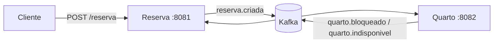

# Hotel: reservas com microsserviços e eventos

Projeto pessoal de estudo: um sistema de reservas de hotel dividido em microsserviços que se comunicam por eventos no Kafka. O objetivo é praticar os padrões de consistência entre serviços (outbox, idempotência, saga) em um domínio simples.

> **Status: em andamento.** O fluxo Reserva ↔ Quarto está implementado. O serviço de Pagamento e a compensação (liberar o quarto quando o pagamento falha) ainda não foram implementados.

## Arquitetura



| Serviço | Porta | Banco | Responsabilidade |
|---|---|---|---|
| `reserva` | 8081 | `reserva` | Recebe o pedido, guarda o estado da reserva (`PENDENTE`, `CONFIRMADA`, `CANCELADA`) |
| `quarto` | 8082 | `quarto` | Cadastro de quartos e bloqueio de datas, sem permitir sobreposição |
| `pagamento` | 8083 | `pagamento` | **Planejado**: aprovar ou recusar o pagamento |

Cada serviço tem o **seu próprio banco** e nenhum acessa o banco do outro. A única forma de conversarem é por eventos.

### Eventos

| Tópico | Publicado por | Consumido por | Conteúdo |
|---|---|---|---|
| `reserva.criada` | Reserva | Quarto | `reservaId`, `quartoId`, `checkIn`, `checkOut` |
| `quarto.bloqueado` | Quarto | Reserva | `reservaId`, `total` |
| `quarto.indisponivel` | Quarto | Reserva | `reservaId`, `motivo` |

## Fluxo

1. `POST /reserva` grava a reserva como `PENDENTE` e **na mesma transação** grava o evento `reserva.criada` na tabela `outbox`. A resposta volta sem esperar o Quarto.
2. Um relay lê a tabela `outbox` e publica no Kafka.
3. O Quarto consome `reserva.criada`, trava a linha do quarto e verifica se o período se sobrepõe a outro bloqueio:
   - **Livre:** grava o `Bloqueio`, calcula o total (noites × diária) e publica `quarto.bloqueado`.
   - **Ocupado ou quarto inexistente:** publica `quarto.indisponivel` com o motivo.
4. A Reserva consome a resposta: com `quarto.bloqueado` grava o total e passa para `CONFIRMADA`; com `quarto.indisponivel` passa para `CANCELADA`.

Por ser assíncrono, o cliente recebe a reserva `PENDENTE` e o resultado final aparece depois (consistência eventual).

## Padrões aplicados

- **Outbox transacional:** o evento é gravado junto com o dado de negócio, na mesma transação, e publicado depois por um relay. Evita perder mensagem se o Kafka estiver fora do ar.
- **Consumidor idempotente:** cada evento tem um `eventoId`, registrado em `processed_event`. Se a mesma mensagem chegar duas vezes, a segunda é ignorada.
- **Lock pessimista:** o Quarto trava a linha do quarto antes de checar a sobreposição, para que duas reservas simultâneas do mesmo quarto sejam processadas uma de cada vez.
- **Período semiaberto `[checkIn, checkOut)`:** quem sai no dia 13 não conflita com quem entra no dia 13. Há sobreposição quando `existente.checkIn < novo.checkOut` e `existente.checkOut > novo.checkIn`.
- **Saga coreografada:** não há orquestrador; cada serviço reage aos eventos do outro.

## Tecnologias

Java 17, Spring Boot 3.5, Spring Data JPA, PostgreSQL, Apache Kafka (Spring Kafka), Maven, Docker (apenas o Kafka).

## Como rodar

**Pré-requisitos:** JDK 17+, Docker, PostgreSQL local.

1. Suba o Kafka:

   ```bash
   cd infra
   docker compose up -d
   ```

2. Crie os bancos no seu PostgreSQL local:

   ```sql
   CREATE DATABASE reserva;
   CREATE DATABASE quarto;
   CREATE DATABASE pagamento;
   ```

3. Defina a senha do banco por variável de ambiente (o padrão é `postgres`):

   ```bash
   export DB_PASSWORD=sua_senha
   ```

   No IntelliJ, use *Run → Edit Configurations → Environment variables*.

4. Suba cada serviço (`quarto` e `reserva`) a partir da sua pasta:

   ```bash
   ./mvnw spring-boot:run
   ```

As tabelas são criadas automaticamente (`ddl-auto=update`), o que serve para estudo, mas não para produção.

## Testando

Cadastre um quarto:

```http
POST http://localhost:8082/quarto
Content-Type: application/json

{ "numero": "101", "tipo": "SOLTEIRO", "diaria": 250.00 }
```

Crie reservas usando o `id` devolvido:

```http
POST http://localhost:8081/reserva
Content-Type: application/json

{ "hospedeId": "hospede-1", "quartoId": 1, "checkIn": "2026-12-10", "checkOut": "2026-12-13" }
```

Cenários para observar na tabela `reserva`:

| Situação | Resultado esperado |
|---|---|
| Quarto livre no período | `CONFIRMADA`, com `total` preenchido |
| Período sobreposto a um bloqueio existente | `CANCELADA` (motivo: período ocupado) |
| Entrada no mesmo dia da saída de outra reserva | `CONFIRMADA` |
| `quartoId` que não existe | `CANCELADA` (motivo: quarto não encontrado) |

## Próximos passos

- [ ] Serviço de Pagamento (`pagamento.aprovado` e `pagamento.recusado`)
- [ ] Compensação: liberar o bloqueio do quarto quando o pagamento for recusado
- [ ] `GET /reserva/{id}` para consultar o status
- [ ] Validação do pedido (datas obrigatórias e `checkOut` depois de `checkIn`)
- [ ] Testes automatizados (regra de sobreposição e idempotência)
- [ ] Constantes compartilhadas para os nomes dos tópicos

## Aviso

Projeto de estudo. As credenciais e configurações são de desenvolvimento e não devem ser usadas em produção.
